# Library Manager

An Android app for running a small library desk, built with Kotlin, Jetpack Compose, Material 3,
Navigation Compose and ViewModel.

Browse and search the catalog, open an item, lend it to a registered member and take it back, add new
books, magazines and DVDs, register members and look at statistics. The app enforces the real rules:
one reader per item, at most 3 items per member, and a different loan period for each item type
(book 21 days, magazine 7, DVD 3).

## Features

- **Catalog** - searchable, filterable list of books, magazines and DVDs. Search by title, author or
  genre; filter by type; show only available items; borrow or return straight from the list.
- **Item details** - all fields of an item (they differ for a book, a magazine and a DVD), its
  availability, and Borrow / Return.
- **Add item** - a form that adapts to the item type, with input filtering and validation messages.
- **Members** - register members, see what each one has borrowed and how much of the limit is used.
- **Stats** - totals, longest book, items by type, the three oldest items, genres.
- Light and dark theme, edge-to-edge layout, landscape support.

## Screenshots

| Catalog | Item details | After borrowing |
|:---:|:---:|:---:|
| 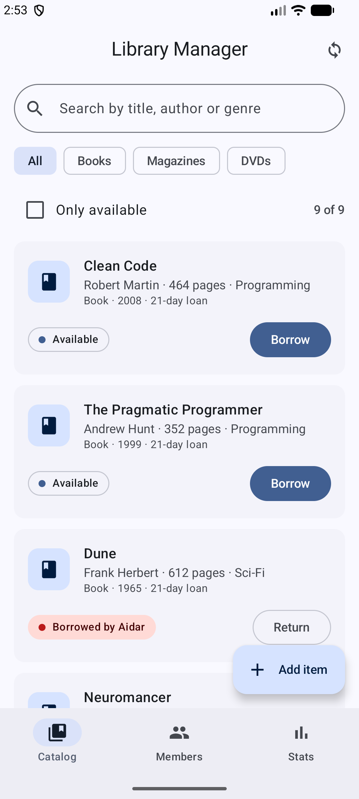 | 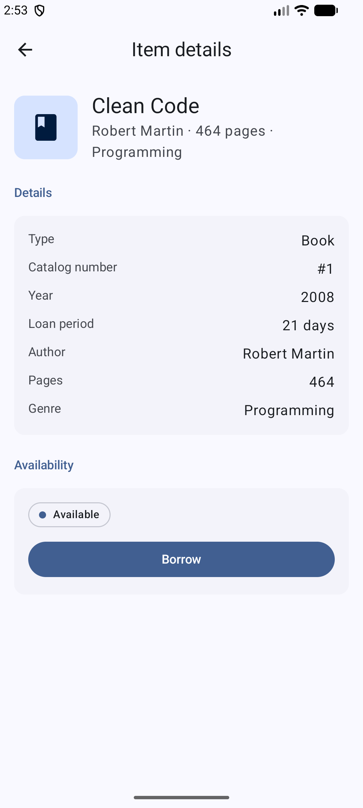 | 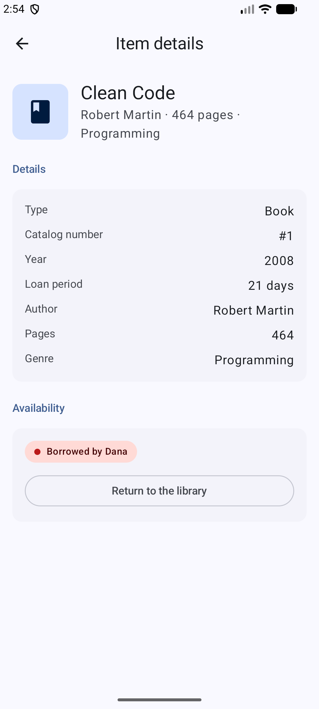 |

| Search | Borrow dialog | Return |
|:---:|:---:|:---:|
| 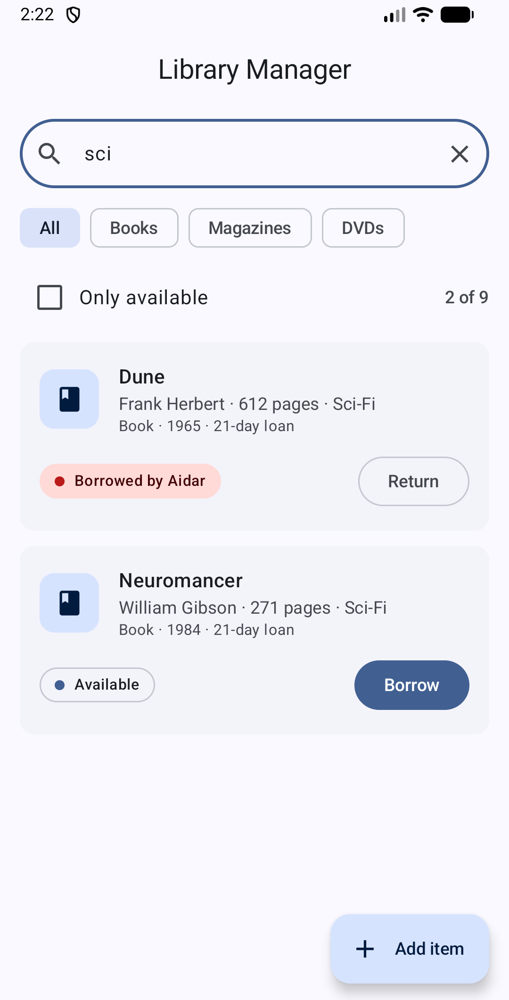 | 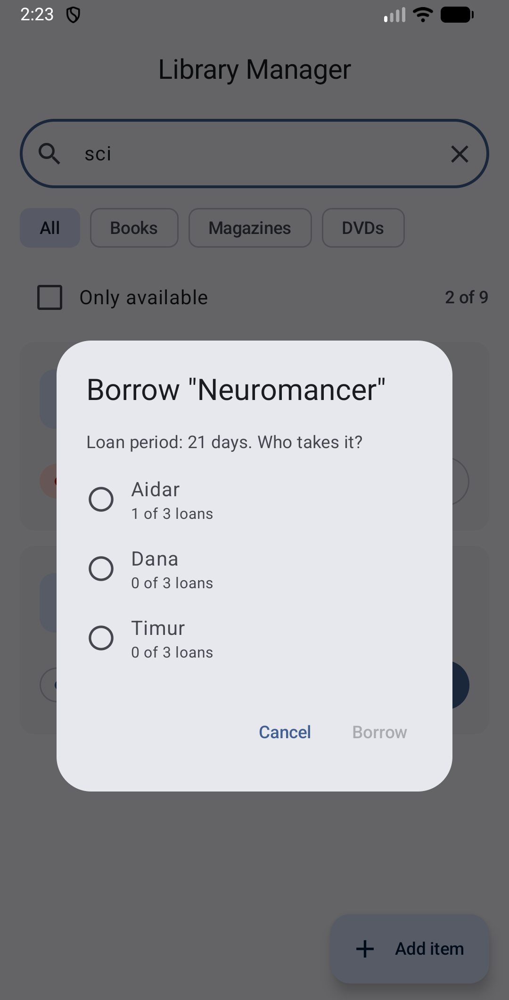 | 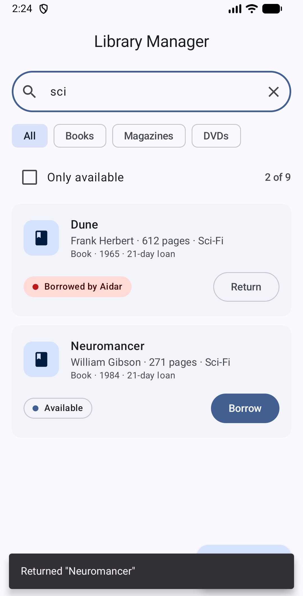 |

| Add item: validation | Item added | Members | Stats |
|:---:|:---:|:---:|:---:|
| 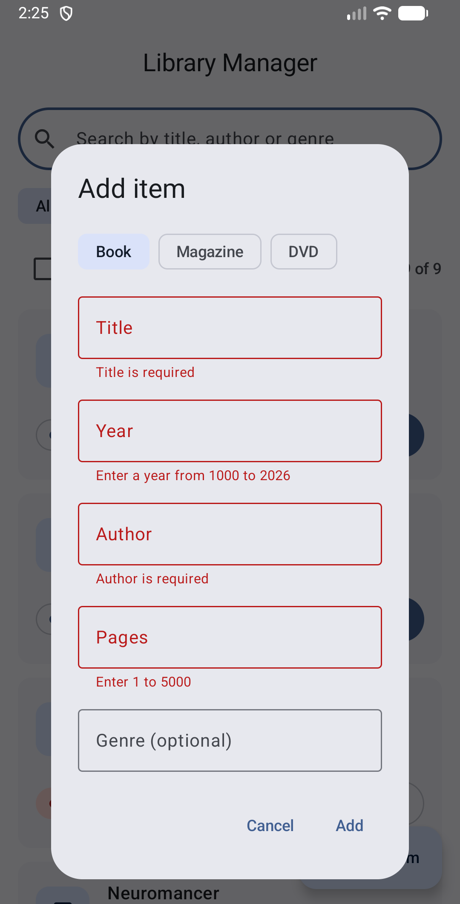 | 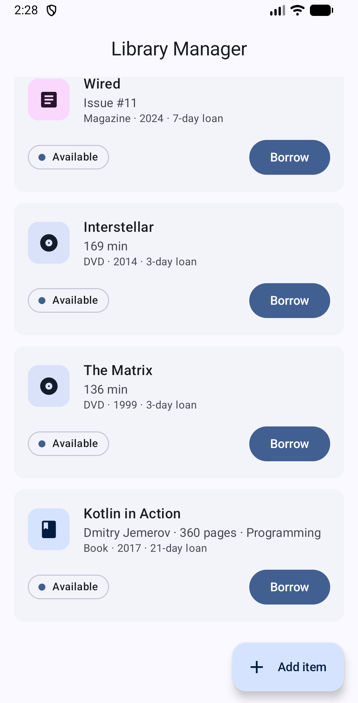 | 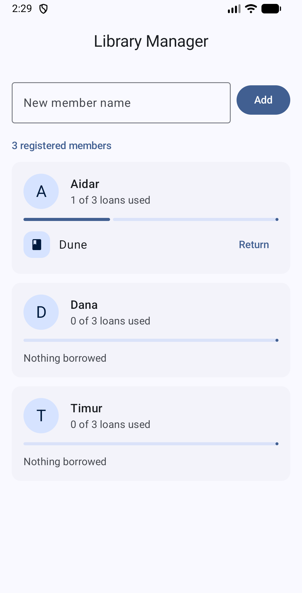 | 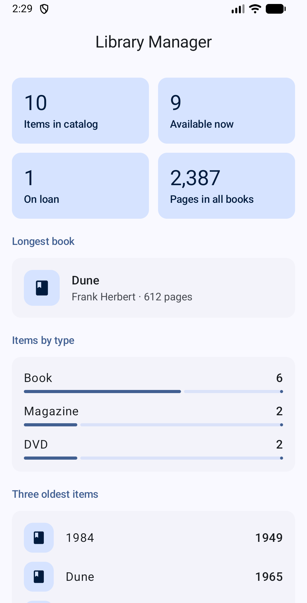 |

Item details in landscape:

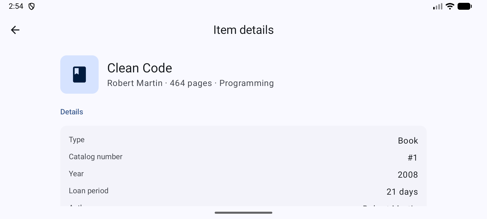

## Tech stack

| | |
|---|---|
| Language | Kotlin 2.4.21 |
| UI | Jetpack Compose (BOM 2026.09.00), Material 3 |
| Navigation | Navigation Compose 2.10.2 |
| State | `ViewModel`, `StateFlow`, `collectAsStateWithLifecycle` |
| Async | Kotlin coroutines (`viewModelScope`, `suspend` functions) |
| Build | Android Gradle Plugin 9.4.1, Gradle 9.7.1 (wrapper), version catalog |
| SDK | minSdk 26, targetSdk / compileSdk 37 |
| Tests | JUnit 4, kotlinx-coroutines-test |

## Getting started

### Prerequisites

- Android Studio (2026.1 or newer recommended)
- JDK 17 or newer (the JDK bundled with Android Studio is fine)
- Internet connection for the first build (Gradle downloads the dependencies)
- An emulator (API 26+) or an Android phone with USB debugging

### Run in Android Studio

1. `File > Open...` and select the `LibraryApp` folder (the one containing `settings.gradle.kts`).
2. Wait for the Gradle sync to finish.
3. Select a device in the toolbar (`Tools > Device Manager` to create an emulator).
4. Press **Run** (`Shift+F10`).

### Run from the terminal

```bash
./gradlew installDebug                                  # build and install on a connected device
adb shell am start -n kz.kbtu.library/.MainActivity     # launch the app
```

If you build only from the terminal, point Gradle to the Android SDK by creating `local.properties`
with `sdk.dir=/path/to/Android/sdk` (or set `ANDROID_HOME`). Android Studio does this automatically.

### Run the tests

```bash
./gradlew testDebugUnitTest
```

The report is written to `app/build/reports/tests/testDebugUnitTest/index.html`.

## Architecture

The app is split into three layers:

```
UI                  ui/screens, ui/components, ui/dialogs, ui/navigation, ui/theme
 |  events (lambdas)                      ^  state (StateFlow<LibraryUiState>)
 v                                        |
State management    LibraryViewModel
 |  calls                                 ^  results
 v                                        |
Domain logic        model/  (plain Kotlin, no Android dependencies)
```

- The UI never changes data itself. It draws the state it receives and reports user actions upwards
  (unidirectional data flow, state hoisting).
- `LibraryViewModel` exposes one immutable `StateFlow<LibraryUiState>`. The UI collects it with
  `collectAsStateWithLifecycle()`, so collection pauses while the app is in the background.
- The `model` package knows nothing about Android and is covered by plain JUnit tests.

### Navigation

```
 start -> Catalog <-> Members <-> Stats          (bottom bar)
            |
            +-- tap a card --> Item details      (route "item/{itemId}")
```

The routes live in `ui/navigation/Screen.kt` and the graph in `ui/navigation/LibraryNavHost.kt`.
Screens do not know about the `NavController`; they receive lambdas from the graph. Only the item id
travels in the route, the details screen reads the item from the shared state. The ViewModel is
obtained above the `NavHost`, so every screen shares the same state.

### State and screen rotation

Rotating the device re-creates the Activity. Nothing the user typed or opened is lost:

| State | Kept by |
|---|---|
| Catalog, members, loans, search text, filters, one-shot messages | `LibraryViewModel` |
| Open dialogs, add-item form fields, typed member name | `rememberSaveable` |
| Opened screen and back stack | `NavController` |
| `SnackbarHostState`, typing buffer of the search box | `remember` (cheap to recreate) |

| | `remember` | `rememberSaveable` | `ViewModel` |
|---|---|---|---|
| Survives recomposition | yes | yes | yes |
| Survives rotation | no | yes | yes |
| Survives process death | no | yes | no |
| Can hold | anything | what fits in a `Bundle` | anything, including logic |
| Typical use | cheap, disposable UI details | UI state worth keeping | screen data and business logic |

## Project structure

```
LibraryApp/
├── app/src/main/java/kz/kbtu/library/
│   ├── MainActivity.kt            single Activity, sets the theme and the root composable
│   ├── model/                     domain logic
│   │   ├── LibraryItem, Book, Magazine, Dvd, Borrowable, ItemType
│   │   ├── Member, Loan, LoanResult (sealed), NewItemData (sealed), LibraryStats
│   │   └── Library.kt             borrow / return / search / stats
│   ├── data/DataLoader.kt         sample data
│   └── ui/
│       ├── LibraryViewModel.kt    screen state and reactions to user actions
│       ├── LibraryUiState.kt      immutable snapshot the UI draws
│       ├── LibraryApp.kt          Scaffold, top bar, bottom bar, Snackbar, NavController
│       ├── navigation/            Screen (routes), LibraryNavHost (graph)
│       ├── screens/               Catalog, ItemDetail, Members, Stats
│       ├── components/            reusable composables
│       ├── dialogs/               AddItemDialog, MemberPickerDialog
│       └── theme/                 colors, typography, theme
├── app/src/test/                  unit tests
├── screenshots/                   images used by this README
└── gradle/libs.versions.toml      library versions
```
