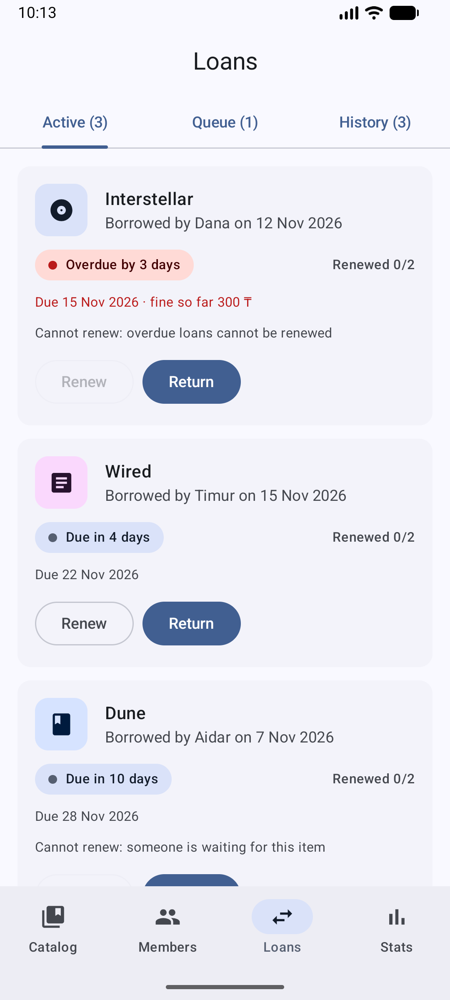
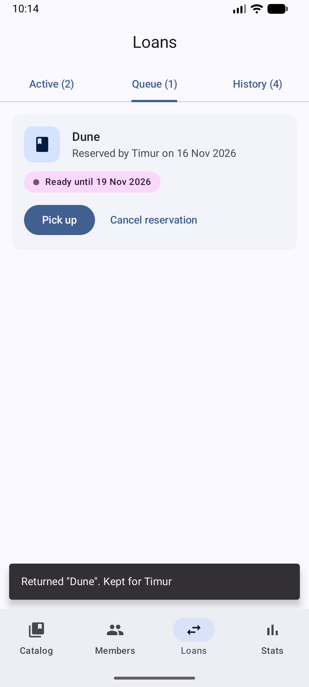
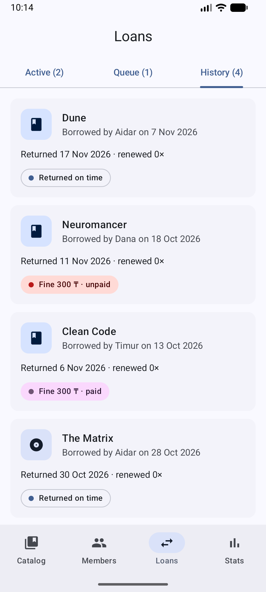
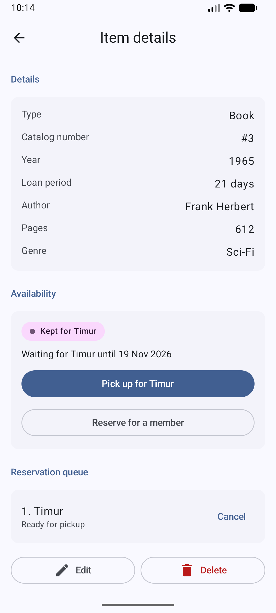
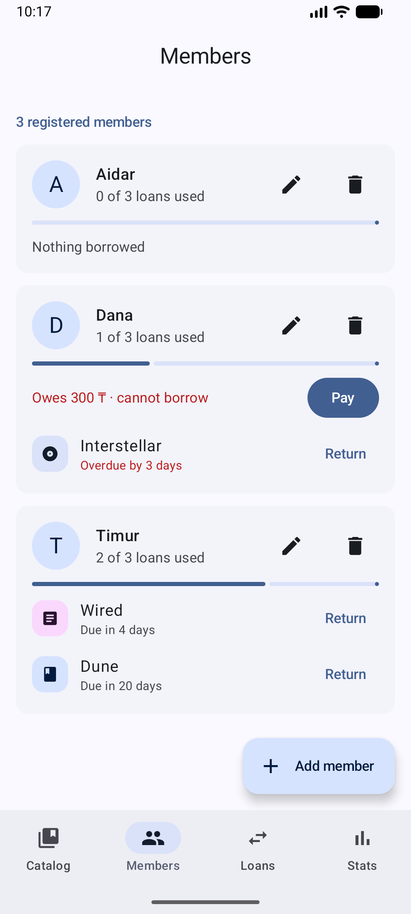
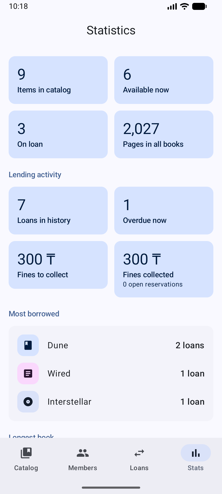
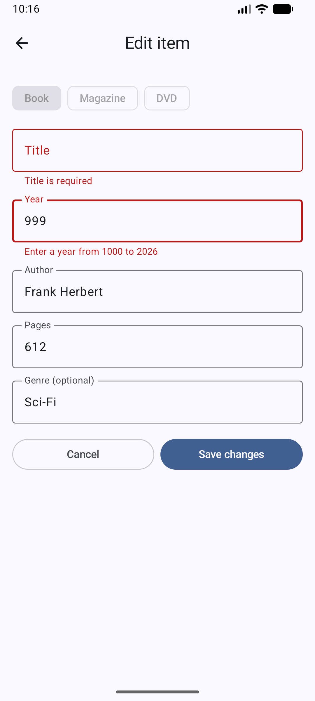

# Library Manager

An Android app for running a small library desk, built with Kotlin, Jetpack Compose, Material 3,
Navigation Compose, **MVVM** and **Room**.

Browse and search the catalog, add, edit and delete books, magazines and DVDs, register members, lend
items and take them back. On top of that the app runs a real **loan desk**: due dates, renewals, a
reservation queue, late fines and loan history. Everything is stored in a local database and survives
restarting the app.

## Features

- **Catalog** - searchable, filterable list of books, magazines and DVDs (`LazyColumn` with stable keys).
  Borrow, return or pick up straight from the list.
- **Item details** - all fields of an item, who has it, due date, reservation queue, and every action on it.
- **Create / edit form** - one full-screen form for all three item types with input filtering and
  validation messages. The type of an existing item is locked.
- **Delete with confirmation** - items and members are removed only after a confirmation dialog.
  An item on loan and a member with open loans cannot be deleted.
- **Members** - register, rename, delete; see loan limit usage, borrowed items and fines; pay fines.
- **Loans (additional feature)** - see below.
- **Stats** - totals, longest book, items by type, oldest items, genres, plus lending statistics.
- Empty states, loading states, Snackbar feedback for every action, light and dark theme, landscape.

## Additional feature: loan desk (workflow with statuses, conditions and history)

Lending is a multi-step workflow with state transitions that are stored in the database.

```
                borrow                     return (late -> fine)
   Available --------------> On loan ---------------------------> Returned (history)
       ^                       |  ^                                   |
       |                renew  |  | (max 2, only if on time,          | fine unpaid
       |                       v  |  nobody waiting)                  v
       |                   On loan, new due date             member cannot borrow
       |                                                       until the fine is paid
       |   reservation queue
       |   WAITING --(item returned)--> READY (kept 2 days) --(pick up)--> FULFILLED
       |                                   |
       +------ hold expires or cancelled --+--> next member in the queue becomes READY
```

| Rule | Value |
|---|---|
| Loan period | book 21 days, magazine 7, DVD 3 |
| Items per member | at most 3 |
| Renewals | at most 2; blocked if the loan is overdue or somebody waits in the queue |
| Late fine | 100 ₸ for every started day after the due date, charged on return |
| Unpaid fine | the member cannot borrow until it is paid (Members tab) |
| Reservation | only for items that are not on the shelf; a returned item is kept 2 days for the first in the queue |
| Hold expired / cancelled | the item goes to the next member in the queue |

The **Loans** tab has three lists: **Active** (due date, overdue status, renew, return),
**Queue** (place in the queue, pick up, cancel) and **History** (returned loans, fines paid / unpaid).
The sample data is created relative to the first launch, so the demo always contains an overdue loan,
a reservation queue and a fine.

## Screenshots

Additional feature:

| Active loans | Reservation queue | Loan history |
|:---:|:---:|:---:|
|  |  |  |

| Item: queue and actions | Members: fines | Statistics |
|:---:|:---:|:---:|
|  |  |  |

Form validation:



## Tech stack

| | |
|---|---|
| Language | Kotlin 2.4.21 |
| UI | Jetpack Compose (BOM 2026.09.00), Material 3 |
| Navigation | Navigation Compose 2.10.2 |
| Architecture | MVVM: `ViewModel`, `StateFlow`, `collectAsStateWithLifecycle` |
| Storage | Room 2.8.5 (KSP 2.3.14), `Flow` queries, transactions |
| Async | Kotlin coroutines (`viewModelScope`, `suspend` DAO methods) |
| Build | Android Gradle Plugin 9.4.1, Gradle 9.7.1 (wrapper), version catalog |
| SDK | minSdk 26, targetSdk / compileSdk 37 |
| Tests | JUnit 4, kotlinx-coroutines-test, AndroidX Test (instrumented, in-memory Room) |

## Architecture

```
UI            screens, components, dialogs, navigation          (Compose, stateless)
 |  events (lambdas)                         ^  state (StateFlow<UiState>)
 v                                           |
ViewModel     Catalog / ItemDetail / ItemForm / Members / Loans / Stats ViewModel
 |  suspend calls                            ^  Flow<LibrarySnapshot>
 v                                           |
Repository    LibraryRepository (interface) <- RoomLibraryRepository
 |                                           ^
 v                                           |
Data source   Room: LibraryDatabase, DAOs, entities  ->  SQLite file
```

- **Unidirectional data flow.** A screen receives an immutable UI state and lambdas. It never changes
  data itself; every user action is a ViewModel method.
- **One source of truth.** The repository exposes `Flow<LibrarySnapshot>` built with `combine` over the
  four Room `Flow` queries. Any write into any table re-emits it, so all screens update on their own.
  Derived values (availability, member status, statistics) are computed in one pure class,
  `LibrarySnapshot`, which is unit tested.
- **Rules in one place.** `LoanPolicy` holds the lending constants and pure functions (due date, fine,
  renew rules). `RoomLibraryRepository` runs each multi-table operation in `db.withTransaction`, so the
  data is never left half changed.
- **ViewModel per screen**, created by `AppViewModelProvider` (manual dependency injection through
  `AppContainer` in `LibraryApplication`). Navigation arguments reach a ViewModel through
  `SavedStateHandle`.
- **User feedback.** ViewModels send short messages to a `Messenger`; the root `Scaffold` shows them in
  a Snackbar, so a message is not lost when its screen closes (for example after saving a form).
- **Configuration changes.** State lives in ViewModels and in the database. Open dialogs use
  `rememberSaveable`. The search box keeps a local copy of its text so typing stays smooth.

### Navigation

```
 start -> Catalog <-> Members <-> Loans <-> Stats        (bottom bar)
            |
            +-- tap a card --> Item details  (item/{itemId}) --Edit--> Item form (item_form/{itemId})
            +-- "Add item" -------------------------------------------> Item form (item_form/-1)
```

## Database

Four tables; deleting an item or a member removes their loans and reservations (foreign keys, cascade).

| Entity | Columns |
|---|---|
| `items` | id, type (BOOK/MAGAZINE/DVD), title, year, author, pages, genre, issueNumber, minutes |
| `members` | id, name |
| `loans` | id, itemId, memberId, borrowedAt, dueAt, returnedAt, renewals, fine, finePaid |
| `reservations` | id, itemId, memberId, createdAt, status (WAITING/READY/FULFILLED/CANCELLED), readyUntil |

CRUD: items (create, read, update, delete), members (create, rename, delete), loans and reservations
(create, update status, history). Sample data is inserted once, in `RoomDatabase.Callback.onCreate`.

## Getting started

### Prerequisites

- Android Studio (2026.1 or newer recommended)
- JDK 17 or newer (the JDK bundled with Android Studio is fine)
- Internet connection for the first build (Gradle downloads the dependencies)
- An emulator (API 26+) or an Android phone with USB debugging

### Run in Android Studio

1. `File > Open...` and select the folder containing `settings.gradle.kts`.
2. Wait for the Gradle sync to finish.
3. Select a device in the toolbar and press **Run** (`Shift+F10`).

### Run from the terminal

```bash
./gradlew installDebug                                  # build and install on a connected device
adb shell am start -n kz.kbtu.library/.MainActivity     # launch the app
```

If you build only from the terminal, create `local.properties` with `sdk.dir=/path/to/Android/sdk`
(or set `ANDROID_HOME`). Android Studio does this automatically.

### Tests

```bash
./gradlew testDebugUnitTest          # 47 JVM tests: rules, snapshot, validation, ViewModels
./gradlew connectedDebugAndroidTest  # 12 tests of the repository on a real in-memory Room database
```

The instrumented tests need a running emulator or device. They cover borrowing rules, the limit, fines,
the reservation queue, expired holds, renewals and the deletion rules.

## Project structure

```
app/src/main/java/kz/kbtu/library/
├── MainActivity.kt, LibraryApplication.kt      entry point, AppContainer (database + repository)
├── model/                                      domain: items, Loan, Reservation, results, LoanPolicy, LibrarySnapshot
├── data/
│   ├── local/                                  Room: entities, DAOs, LibraryDatabase, SeedData
│   └── repository/                             LibraryRepository, RoomLibraryRepository, mappers
└── ui/
    ├── viewmodel/                              one ViewModel + UI state per screen, LoanActions, factory
    ├── screens/                                Catalog, ItemDetail, ItemForm, Members, Loans, Stats
    ├── components/, dialogs/                   reusable composables
    ├── navigation/                             routes and NavHost
    ├── theme/, util/, Messenger.kt, LibraryApp.kt
app/src/test/                                   JVM unit tests (fake repository for ViewModels)
app/src/androidTest/                            instrumented repository tests (in-memory Room)
```
